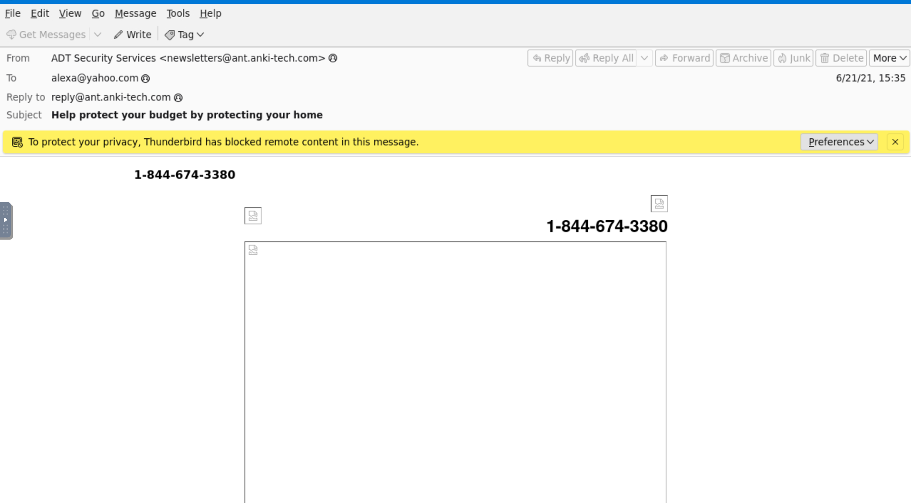
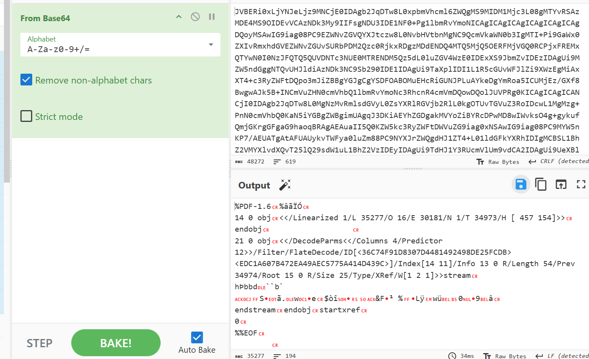
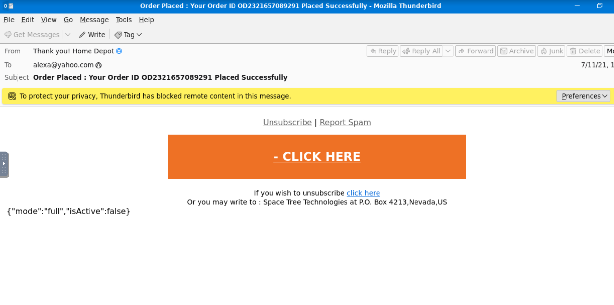
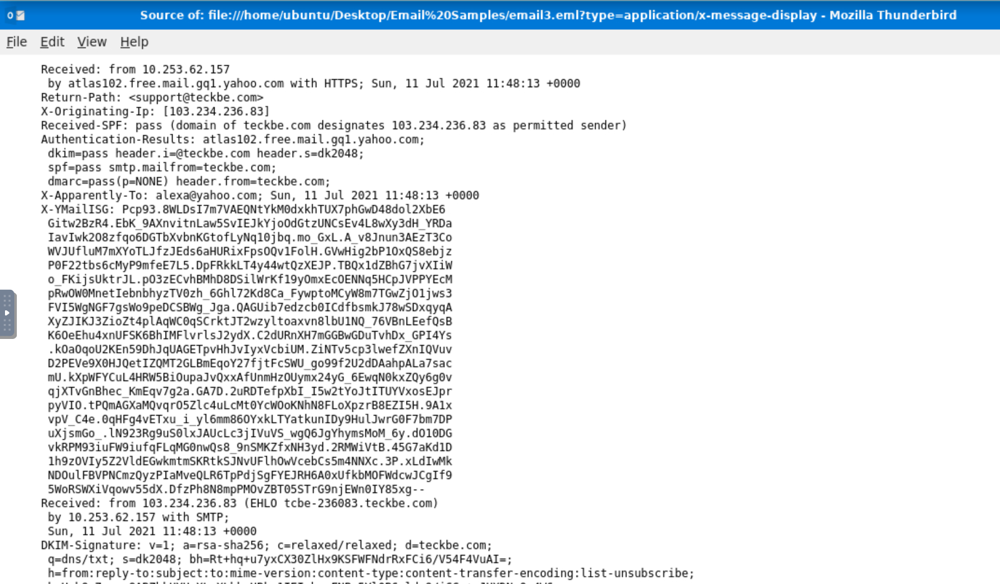

# Phishing Email Analysis — TryHackMe Lab

A hands-on email analysis project covering sender identification, email headers, authentication results, Base64 attachment decoding, and phishing indicators.

> **Disclaimer:** This project documents guided cybersecurity lab exercises using TryHackMe sample emails. It is for educational purposes and does not represent a real-world incident investigation.

## Project Overview

| Detail | Description |
|---|---|
| Project type | Hands-on cybersecurity lab |
| Focus | Email analysis and phishing indicators |
| Samples analysed | 3 |
| Tools | Mozilla Thunderbird, CyberChef |
| Learning platform | TryHackMe |

### Objective

To inspect three email samples, examine sender information and email headers, identify suspicious indicators, and extract information from a Base64-encoded attachment.

## Tools Used

- **Mozilla Thunderbird:** Viewed email messages and inspected raw email source.
- **CyberChef:** Decoded Base64-encoded attachment content.
- **TryHackMe:** Provided the sample emails and practical exercises.

## Sample Analysis

### 1. ADT Security Services Email

**Subject:** Help protect your budget by protecting your home

**Display name:** ADT Security Services  
**From:** `newsletters@ant.anki-tech.com`  
**Reply-To:** `reply@ant.anki-tech.com`

**Observations:**

- The display name refers to ADT Security Services, but the sender address uses `ant.anki-tech.com`.
- SPF, DKIM and DMARC authentication results were reported as passing for the sending domain.
- The email contained a prominent telephone number and links associated with the sender's domain.
- Thunderbird blocked remote content.

**Analysis:**

The difference between the claimed organization and the sender domain is suspicious and may indicate brand impersonation.

Passing SPF, DKIM and DMARC checks does not prove that the message genuinely represents ADT. These checks authenticate aspects of the sending domain; they do not independently verify the claimed brand identity.

**Assessment:** Suspicious; possible brand impersonation. Further verification would be required for a definitive verdict.

### 2. Base64-Encoded Attachment

**Attachment filename:** `zmqpalgh.pdf`  
**Content type:** `application/pdf`  
**Content transfer encoding:** `base64`

**Observations:**

- The email source contained a Base64-encoded attachment.
- I extracted the encoded content.
- I used CyberChef's `From Base64` operation to decode it.
- The decoded output began with the `%PDF-1.6` file signature.
- I saved the decoded content as a PDF and retrieved the TryHackMe lab flag.

**Analysis:**

Base64 is an encoding method, not encryption. Decoding restores the original data, but it does not establish whether an attachment is safe or malicious.

**Assessment:** Successfully extracted and decoded the lab attachment. No malware analysis or independent safety verification of the PDF was performed.

### 3. Home Depot-Themed Email

**Display name:** Thank you! Home Depot  
**From:** `support@teckbe.com`  
**Subject:** Order Placed: Your Order ID ... Placed Successfully

**Observed header information:**

| Header or field | Observed value |
|---|---|
| Claimed organization | Home Depot |
| Sender address | `support@teckbe.com` |
| Reply-To | `support@teckbe.com` |
| Return-Path | `support@teckbe.com` |
| X-Originating-IP | `103.234.236.83` |
| Authentication-Results server | `atlas102.free.mail.gq1.yahoo.com` |
| SPF | Pass |
| DKIM | Pass |
| DMARC | Pass |

**Observations and analysis:**

- The displayed organization was Home Depot, while the sender used the `teckbe.com` domain.
- The originating IP was identified in the `X-Originating-IP` header.
- The Authentication-Results header was generated by `atlas102.free.mail.gq1.yahoo.com`.
- The email body contained a prominent "CLICK HERE" call to action and links using the `t.teckbe.com` domain.
- The authentication checks passed for the sending domain, but this did not establish a genuine relationship with Home Depot.

The links were identified in the email but were not opened or independently investigated.

**Assessment:** Suspicious; possible brand impersonation.

**Email message evidence:**

**Raw email header evidence:**

## Key Technical Concepts Learned

### Email protocols

- **SMTP:** Used to send and relay email.
- **IMAP:** Synchronizes mailbox messages across devices.
- **POP3:** Traditionally downloads messages from a mail server.

### Email headers

Email headers provide information that helps analysts examine sender identity, routing and authentication.

Relevant fields examined included:

- From
- Reply-To
- Return-Path
- Received
- X-Originating-IP
- Authentication-Results

### Base64 encoding

Base64 converts data into a text representation. It is not encryption and can be decoded to recover the original data.

### Defanging indicators

Defanging changes the appearance of indicators to reduce the risk of accidental interaction.

Example:

`103.234.236.83` → `103[.]234[.]236[.]83`

The original indicator should be preserved securely when maintaining investigation evidence.

### Email authentication

SPF, DKIM and DMARC help authenticate aspects of email delivery. A passing result does not guarantee that an email is legitimate, harmless or genuinely associated with the brand shown in its display name.

## Limitations

This was a guided lab exercise, not a real-world incident investigation.

The following activities were not performed:

- Independent reputation checks of sender domains or IP addresses.
- Safe inspection or reputation analysis of URLs.
- Detonation or sandbox analysis of attachments.
- Malware scanning or reverse engineering.
- Verification with the impersonated organizations.

The assessments in this report are based only on the evidence examined during the lab.

## Conclusion

These exercises provided practical exposure to inspecting email source information, identifying sender-domain inconsistencies, interpreting email authentication results, locating originating IP information and extracting Base64-encoded attachment content.

An important takeaway was that email authentication passing does not automatically make a message trustworthy. Analysts must consider the claimed sender identity, actual sending domain, email content and other available evidence together.

## Project Status

Initial lab analysis documented. Further practical investigations are required to develop these skills beyond guided exercises.

---

**Learning platform:** TryHackMe  
**Tools:** Mozilla Thunderbird, CyberChef  
**Focus:** Email and phishing analysis
